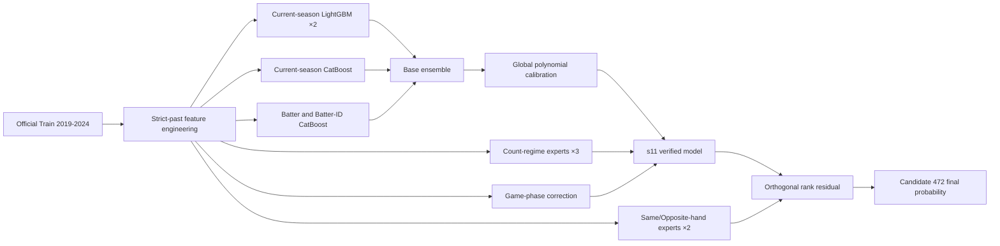

# Strike Ratio

> 투구 직전까지 확인 가능한 경기 상황과 선수 이력을 이용해 제구 성공 확률을 예측하는 LG Aimers Phase 2 프로젝트


| 구분 | 내용 |
|---|---|
| 프로젝트 유형 | LG Aimers Phase 2 해커톤 · 개인 프로젝트 |
| 개발 기간 | **2026.08.05 ~ 2026.09.02** |
| 담당 | 데이터 감사, 피처 엔지니어링, 검증 설계, 모델링, 앙상블, calibration, 제출 패키징 |
| 예측 대상 | 각 투구의 `control_success=1` 확률 |
| 공식 확인 최고 점수 | **1046.2789329284** (`s11_fixed`) |
| 최종 연구 모델 | Candidate 472 · rank-only same/opposite-hand ensemble |

> [!IMPORTANT]
> **공식 최고 모델과 최종 연구 모델은 구분됩니다.** `s11_fixed`는 리더보드에서 1046.2789점을 확인한 안정 모델입니다. Candidate 472는 이후 rolling-origin 검증에서 추가 신호를 확인해 최종화한 공격적 모델이지만, 최초 제출 ZIP의 자산 누락 오류로 공식 점수는 확인하지 못했습니다. 현재 저장소의 패키징 방식은 이 문제를 수정했습니다.

## 📌 프로젝트 소개

### 왜 시작했는가

이 대회는 단순한 성공/실패 분류가 아니라 **제구 성공 확률 자체의 정확성**을 평가합니다. 순위를 잘 구분하는 모델도 확률이 과도하게 높거나 낮으면 Brier Score가 악화됩니다. 또한 2019~2024 시즌으로 학습한 모델을 2025 환경에 배포해야 하므로 다음 세 가지를 동시에 해결해야 했습니다.

- 투구 시점 이후의 정보를 사용하지 않는 시간 누수 방지
- 투수·타자·카운트·주자·경기 상황을 함께 반영하는 tabular 모델링
- 시즌 분포 변화에도 무너지지 않는 확률 보정과 검증

### 해결하려는 문제

- 약 147만 건의 학습 투구에서 안정적인 선수·상황 신호 추출
- 선수 누적 기록을 현재 행보다 과거 정보만으로 구성
- `pitcher_id`와 `pitcher_trackman_id`가 다른 TrackMan 데이터의 연결 가능성 검토
- pooled Brier는 좋아지지만 특정 시즌이나 타깃에서 악화되는 모델 차단
- Windows에서 생성한 제출 ZIP을 Linux `/app` 평가 환경에서 재현

### 핵심 원칙

- **Strict-past**: 현재 투구 결과와 미래 정보는 어떤 누적 피처에도 포함하지 않습니다.
- **Temporal validation**: 랜덤 분할 대신 시즌 순서가 유지되는 expanding validation을 사용합니다.
- **Calibration first**: AUC와 Brier를 분리해 보고, 확률 수준의 오류를 별도로 교정합니다.
- **Target balance**: 전체 평균뿐 아니라 `y=0`, `y=1` Brier 변화를 함께 확인합니다.
- **Reproducibility**: 실험 설정, 모델 artifact, 체크섬, 제출 구조를 기록합니다.
- **Rule compliance**: 테스트 행·ID·구간별 리더보드 탐색이나 정답성 외부 정보는 사용하지 않습니다.

## 🎯 평가 방식

예측 확률 `p_i`, 실제 정답 `y_i`, 평가 데이터의 평균 성공률 `r`에 대해 다음 Brier Skill Score를 사용합니다.

```text
Brier Score     = mean((p_i - y_i)^2)
Reference Brier = r * (1 - r)
Score           = max(0, 100000 * (1 - Brier Score / Reference Brier))
```

평가 데이터의 평균 성공률 `r`은 비공개입니다. 따라서 단순 분류 정확도나 AUC만 높이는 것으로는 충분하지 않고, 예측 확률의 평균·분산·극단값까지 안정적으로 보정해야 합니다. 이 특성 때문에 본 프로젝트는 모델 학습과 calibration을 별도 문제로 다뤘습니다.

## 🧰 기술 스택

| 영역 | 기술 | 사용 목적 |
|---|---|---|
| Language | Python | 학습·검증·추론·패키징 |
| Data | Pandas, NumPy | 시점 기준 통계, 피처 생성, 대용량 CSV 처리 |
| Gradient Boosting | LightGBM 4.6.0 | 현재 시즌 투수 상태 모델 |
| Categorical Boosting | CatBoost 1.2.10 | 선수 ID, 범주형 상호작용, 전문가 모델 |
| Optimization | SciPy | 앙상블 가중치와 제약식 최적화 |
| Validation | Brier Score, ROC-AUC, rolling-origin | 확률 정확도와 구분력 검증 |
| Integrity | SHA-256, ZIP manifest | 모델 자산 및 제출물 무결성 검사 |
| Version Control | Git, GitHub | 실험 결과와 최종 artifact 관리 |

## 📊 데이터

| 데이터 | 규모/기간 | 역할 |
|---|---:|---|
| Train | 1,475,092 투구 · 2019~2024 | 모델 학습과 시즌 순차 검증 |
| Test | 245,789 투구 · 2025 | 최종 확률 추론 |
| TrackMan history | 1,793,078 투구 · 2019~2024 | 구속·무브먼트 등 보조 신호 연구 |

대회 데이터는 라이선스와 용량 문제로 저장소에 포함하지 않습니다. `train.csv`, `test.csv`, `trackman_history.csv` 모두 Git에서 제외했습니다.

### 주요 피처 그룹

- 경기 상태: 이닝, 아웃카운트, 볼·스트라이크, 주자 상태, 점수 차, 레버리지
- 선수 정보: 투수·타자 ID, 손잡이, 소속 팀, 투타 손 조합
- 누적 능력: 투수·타자 성공률, 중간 제구율, 볼·스트라이크 비율
- 최근 흐름: 이전 1·3·5경기 성공률과 중간 제구율
- 신뢰도: 누적 표본 수, shrinkage 통계, cold-start 여부
- 구종 구성: fastball·breaking·offspeed 비율, entropy, HHI, 구성 차이
- 상호작용: 투수×타자 능력 차이, count×hand, base×outs, leverage×count
- 현재 시즌: 커리어 누적치에서 이전 시즌 baseline을 분리해 계산한 시즌 내 상태

## 🏗️ 모델링 파이프라인



### 1. 현재 시즌 기본 모델

두 LightGBM 예측을 `0.6 : 0.4`로 결합하고 CatBoost와 다시 앙상블했습니다. 이전 시즌까지의 baseline과 현재 누적 통계 차이를 이용해 현재 시즌 투수 상태를 분리했습니다.

### 2. 타자 및 ID 모델

타자 현재 시즌 표본이 충분한 행에만 타자 상태 모델을 제한적으로 반영했습니다. 이어서 타자 ID CatBoost를 결합해 선수별 반복 패턴을 보완했습니다.

### 3. 전역 확률 보정

기본 예측을 바꾸지 않고 offset·slope·고차항을 적용한 전역 calibration이 가장 큰 리더보드 상승을 만들었습니다. 이는 당시 병목이 구분력뿐 아니라 2025 확률 수준의 mismatch였음을 보여줍니다.

### 4. Count-regime 전문가

카운트를 다음 세 구간으로 분리해 142개 피처를 사용하는 CatBoost 전문가를 학습했습니다.

- `balls > strikes`: batter ahead
- `balls = strikes`: even
- `balls < strikes`: pitcher ahead

검증에서 선택한 regime 기여도는 `0.0449386515`이며, phase 보정 가중치는 `1.3580533342`입니다.

### 5. Same/Opposite-hand 전문가와 rank-only 결합

투수와 타자의 손 조합을 네 그룹으로 쪼개면 표본이 부족해졌습니다. 이를 동일 손과 반대 손 두 그룹으로 합쳐 독립 CatBoost 전문가를 학습했습니다.

전문가 확률을 그대로 섞었을 때 AUC는 상승했지만 타깃별 Brier가 크게 갈렸습니다. 최종 모델에서는 전문가와 s11의 logit 차이에서 절편과 s11-logit 방향을 제거했습니다.

```text
z_base = logit(p_s11)
delta  = logit(p_hand_expert) - z_base
rank_residual = (delta - (a + b * z_base)) / scale
z_final = z_base + w * rank_residual
p_final = sigmoid(z_final)
```

동결된 값은 다음과 같습니다.

| 파라미터 | 값 |
|---|---:|
| Projection intercept `a` | 0.01615592 |
| Projection slope `b` | -0.12655296 |
| Residual scale | 0.09701518 |
| Rank weight `w` | 0.02396058 |

이 구조는 전문가가 가진 **행별 순위 정보만 전달하고 평균 확률과 기존 calibration 방향은 최대한 보존**합니다.

## 🧪 검증 전략

### Expanding rolling-origin

```text
2019~2021 학습 → 2022 평가
2019~2022 학습 → 2023 평가
2019~2023 학습 → 2024 평가
2019~2024 전체 재학습 → 2025 배포
```

모델·가중치·보정값은 selection 시즌에서 결정한 뒤 confirmation 시즌에는 고정했습니다. 다음 항목을 동시에 확인했습니다.

- 전체 Brier delta
- `target=0`, `target=1`별 Brier delta
- ROC-AUC delta
- 시즌·월별 승리 개수
- 최근 시즌 평균 개선량
- 테스트 데이터 접근 여부와 사전등록 설정

### Candidate 471 검증 결과

Candidate 472가 사용하는 rank-only 구조를 s11과 비교한 결과입니다.

| 평가 시즌 | Brier delta | AUC delta | 해석 |
|---|---:|---:|---|
| 2022 | **-0.00003250** | **+0.00030838** | 선택 시즌, 양 타깃 개선 |
| 2023 | **-0.00018680** | **+0.00045012** | 양 타깃 및 전체 개선 |
| 2024 | **-0.00001621** | **+0.00018615** | 전체 개선, 타깃 1 불안정 |

Brier delta는 음수일수록 좋습니다. 모든 시즌에서 전체 Brier와 AUC는 개선됐지만 2024 타깃 1이 악화되어 엄격한 target-balance gate는 통과하지 못했습니다. 따라서 472는 안정 모델이 아닌 공격적 최종 연구 후보입니다.

## 📈 실험 흐름과 성능 변화

### 공식 리더보드에서 확인한 핵심 변화

| 단계 | 점수 | 의미 |
|---|---:|---|
| 초기 고점 기준 | 1008.1374 | 구조·피처 실험의 기준점 |
| 전역 calibration 적용 | 1033.0961 | 모델 순위를 유지한 채 확률 수준 교정 |
| count-regime 구조 개선 | 1044.5371 | 상황별 전문가 신호 추가 |
| s11 verified | **1046.2789** | 공식 확인 최고 점수 |

### 주요 연구 방향

| 방향 | 결과와 판단 |
|---|---|
| LightGBM·XGBoost·CatBoost | 안정적인 tabular 기준선 구축 |
| 현재 시즌 투수·타자 피처 | 최종 앙상블의 핵심 신호로 채택 |
| 타자 ID와 범주형 상호작용 | 반복 선수 패턴 보완, 최종 채택 |
| TabM·FT-Transformer·Wide&Deep·SSL | 최근 시즌에서 안정적인 우위가 없어 미채택 |
| 전역 affine·polynomial calibration | 가장 큰 단일 리더보드 개선 |
| Dynamic Beta·상태공간 모델 | pooled Brier 개선, confirmation 타깃 균형 실패 |
| GroupDRO·잔차 보정 | 특정 시즌/타깃 손실을 줄이려 했으나 안정적 승격 실패 |
| TrackMan 피처 | 매핑은 가능했지만 잘못된 연결과 시즌 전이 위험으로 최종 제외 |
| 세밀한 count×hand lookup | 로컬 개선 대비 과적합 위험이 커 중단 |
| 동일/반대 손 전문가 | 모든 평가 연도 AUC 개선, 확률 편향 발생 |
| Orthogonal rank residual | 편향을 크게 줄이며 새 구분력만 전달, 최종 후보 채택 |

상세 실험 기록은 [`docs/EXPERIMENT_LOG.md`](docs/EXPERIMENT_LOG.md), 전체 수치 테이블은 [`docs/results.csv`](docs/results.csv)에 있습니다.

## 🛠️ 트러블슈팅

### 1. 로컬 Brier 개선이 리더보드로 전이되지 않음

**문제**
여러 residual 보정이 2020~2022 pooled Brier를 개선했지만 2025 리더보드에서는 점수가 하락했습니다.

**원인**
연도별 타깃 평균이 지속해서 이동했고, 오래된 시즌의 개선이 pooled 평균을 지배했습니다. 동일 OOF를 반복 확인하면서 검증셋도 사실상 선택 과정에 노출됐습니다.

**해결 과정**

- pooled 평균 대신 2023·2024 동시 개선을 우선
- expanding rolling-origin으로 검증 재설계
- 최소 개선량과 타깃별 손실 상한 설정
- calibration 이후에도 남는 AUC/Brier 개선만 새 정보로 인정

**결과**
미세한 후처리 실험을 줄이고, 실제 새 구분력을 제공하는 전문가 모델 중심으로 전환했습니다.

### 2. AUC는 개선되지만 한 타깃의 Brier가 붕괴

**문제**
손 조합 전문가는 모든 연도 AUC를 개선했지만 `target=0` 또는 `target=1` 한쪽 확률을 과도하게 밀었습니다.

**원인**
전문가 확률에는 순위 신호뿐 아니라 시즌별 평균과 calibration 차이가 함께 들어 있었습니다.

**해결 과정**
전문가와 s11의 logit 차이를 기존 s11 logit에 회귀시켜 절편·기울기 방향을 제거하고 표준화한 residual만 결합했습니다.

**결과**
2022~2024 전체 Brier와 AUC가 모두 개선됐고, 직접 확률 혼합보다 타깃 편향이 감소했습니다.

### 3. Train과 TrackMan에 직접 연결키가 없음

**문제**

```text
train.csv            → pitcher_id
trackman_history.csv → pitcher_trackman_id
```

두 ID는 직접 JOIN할 수 없었습니다.

**해결 과정**

- 시즌×월별 투구 수를 선수 fingerprint로 생성
- 같은 투구손과 활동 시즌으로 후보 제한
- cosine similarity와 활동 시즌 일치도 계산
- mutual-best와 1·2위 margin으로 애매한 매핑 보류
- 고신뢰/중신뢰/미매핑으로 등급화

**결과**
약 80% 수준의 투구 coverage를 확보할 수 있었지만, 일부 잘못된 매핑과 2025 전이 불안정성이 최종 모델의 이득보다 컸습니다. TrackMan은 최종 모델에서 제외했습니다.

### 4. 미래 정보 누수 위험

**문제**
선수 누적률이나 최근 경기 통계를 잘못 계산하면 현재 투구 결과 또는 이후 경기 정보가 피처에 포함될 수 있습니다.

**해결 과정**

- 모든 누적 피처를 현재 행 이전 시점으로 shift
- 시즌 순서를 보존한 학습·평가
- 테스트 전체 통계를 이용한 보정 금지
- 행별 추론이 다른 테스트 행의 존재에 의존하지 않도록 구성

**결과**
최종 추론은 각 행의 공식 제공 as-of 정보와 저장된 모델 artifact만 사용합니다.

### 5. Windows ZIP은 로컬에서 열리지만 Linux 평가 서버에서 모델 누락

**문제**
평가 서버에서 다음 오류가 발생했습니다.

```text
FileNotFoundError: Missing model asset: /app/model/current_season_lgbm_095.txt
```

**원인**
코드의 `/app/model/...` 경로 해석은 정상이었지만, Windows에서 생성한 제출 ZIP의 서버 압축 해제 결과에 필수 모델 자산이 존재하지 않았습니다. 로컬 실행 확인만으로 ZIP 내부 엔트리와 업로드 결과까지 보장하지 못했습니다.

**해결 과정**

- Windows 절대경로 제거, `Path(__file__).resolve().parent` 사용
- `Compress-Archive` 대신 POSIX `/` 엔트리를 생성하는 `tar` 사용
- 필수 자산 16개의 존재 여부 사전 검사
- 원본 artifact SHA-256 검증
- ZIP 생성 후 내부 엔트리 재검사
- 압축 해제본으로 실제 추론 및 `submission.csv` 생성 확인

**결과**
현재 [`tools/build_submission.ps1`](tools/build_submission.ps1)은 Windows에서 실행해도 Linux 호환 ZIP 구조를 생성하며, 누락·변조·역슬래시 경로가 있으면 즉시 실패합니다.

## 📁 프로젝트 구조

```text
Strike_Ratio/
├── final_model/
│   ├── model/                    # LightGBM·CatBoost·calibration artifact
│   ├── MANIFEST.sha256           # 모델·코드 무결성 체크섬
│   ├── MODEL_CARD.md             # 최종 모델 검증 결과와 위험
│   ├── requirements.txt
│   └── script.py                 # 평가 서버용 추론 코드
├── docs/
│   ├── EXPERIMENT_LOG.md         # 전체 실험 의사결정 기록
│   ├── results.csv               # 실험 수치 테이블
│   └── *_preregistered.json      # 469~472 사전등록 설정
├── tools/
│   └── build_submission.ps1      # POSIX ZIP 생성·무결성 검사
├── .gitattributes
├── .gitignore
└── README.md
```

민감 정보, 원본 대회 데이터, TrackMan CSV, 강의자료, 가상환경, 중간 체크포인트와 과거 제출물은 저장소에 포함하지 않았습니다.

## 🚀 실행 방법

### 사전 요구사항

- Python 3.10 이상
- 평가 데이터의 원본 컬럼 구조
- 인터넷 연결 없이 설치 가능한 `lightgbm==4.6.0`, `catboost==1.2.10`

### 로컬 추론

평가 서버와 같은 구조로 데이터를 배치합니다.

```text
final_model/
├── data/
│   ├── test.csv
│   └── sample_submission.csv
└── output/
```

```bash
pip install -r final_model/requirements.txt
python final_model/script.py
```

결과는 `final_model/output/submission.csv`에 생성됩니다. 입력 `row_id`의 순서와 출력 행 수가 다르면 추론 코드가 실패하도록 방어 검사를 넣었습니다.

### 제출 ZIP 생성

Windows PowerShell:

```powershell
./tools/build_submission.ps1
```

생성 결과:

```text
dist/submit.zip
├── model/
├── script.py
└── requirements.txt
```

ZIP 최상위에 추가 폴더가 생기거나 내부 경로에 `\`가 포함되면 빌드가 실패합니다.

## 🔐 대회 규칙과 재현성

- 공식 제공 Train 데이터와 허용 범위의 보조 데이터만 사용했습니다.
- 테스트 정답 또는 정답과 직접 연결되는 외부 정보는 사용하지 않았습니다.
- 특정 테스트 행, 선수 ID, 구간을 리더보드 결과에 맞춰 수정하지 않았습니다.
- 전역 calibration과 앙상블 가중치는 기록된 실험 근거에 따라 결정했습니다.
- 최종 추론은 네트워크 접근 없이 재현됩니다.
- 원본 데이터는 GitHub에 업로드하지 않았습니다.
- 모델 파일과 추론 코드는 [`MANIFEST.sha256`](final_model/MANIFEST.sha256)으로 검증합니다.

## ⚠️ 한계

- 2019~2024와 2025 사이의 타깃 분포 이동 때문에 과거 시즌 개선이 리더보드로 그대로 전이되지 않았습니다.
- Candidate 472는 2024 `target=1` 안정성 게이트를 통과하지 못한 공격적 후보입니다.
- TrackMan은 높은 잠재력이 있었지만 ID 매핑 오차와 전이 위험 때문에 최종 모델에 포함하지 않았습니다.
- 저장소는 대회 데이터와 전체 학습 체크포인트를 포함하지 않아 완전 재학습보다 최종 추론 재현에 초점을 둡니다.
- 공식 점수가 확인된 가장 안전한 결과는 s11의 **1046.2789329284**입니다.

## 👤 프로젝트 소개

| 구분 | 내용 |
|---|---|
| 프로젝트 유형 | 개인 프로젝트 |
| 개발 기간 | 2026.08.05 ~ 2026.09.02 |
| 역할 | 데이터 감사부터 모델링·검증·패키징·문서화까지 전체 수행 |
| 저장소 | [github.com/koolhol/Strike_Ratio](https://github.com/koolhol/Strike_Ratio) |

## 📝 회고

### 배운 점

- 확률 예측에서는 AUC보다 calibration이 리더보드에 더 큰 영향을 줄 수 있습니다.
- 시계열 tabular 문제는 평균 성능보다 최신 시즌과 하위 그룹의 방향 일관성이 중요합니다.
- 새 모델의 확률을 직접 섞기보다 기존 모델과 직교화한 잔차만 전달하면 중복 신호와 calibration 훼손을 줄일 수 있습니다.
- 외부 보조 데이터는 피처 품질 이전에 ID 연결 품질과 시간 기준을 먼저 검증해야 합니다.
- 코드가 로컬에서 실행되는 것과 제출 ZIP이 Linux 서버에서 재현되는 것은 별개의 검증 단계입니다.

### 아쉬운 점

- 반복 실험으로 동일 OOF에 대한 선택 편향이 누적됐습니다.
- TrackMan 신호를 안정적으로 배포할 만큼 매핑 품질과 validation gap을 해결하지 못했습니다.
- 최종 Candidate 472의 공식 리더보드 점수를 패키징 오류 때문에 확인하지 못했습니다.

### 다음에 개선한다면

- 처음부터 완전히 잠긴 최종 holdout과 실험 예산을 설정합니다.
- calibration과 ranking 모델을 분리한 목적함수를 사용합니다.
- 선수 계층 prior와 최근 시즌 상태를 결합한 계층형 Bayesian 모델을 검토합니다.
- Linux 컨테이너에서 ZIP 생성부터 추론까지 수행하는 CI smoke test를 추가합니다.

## 📚 문서

- [최종 모델 카드](final_model/MODEL_CARD.md)
- [전체 실험 로그](docs/EXPERIMENT_LOG.md)
- [실험 결과 테이블](docs/results.csv)
- [469 사전등록 설정](docs/s11_same_opposite_hand_experts_469_preregistered.json)
- [470 사전등록 설정](docs/s11_same_opposite_balanced_470_preregistered.json)
- [471 사전등록 설정](docs/s11_same_opposite_rank_only_471_preregistered.json)
- [472 배포 설정](docs/s11_same_opposite_rank_deploy_472_preregistered.json)
