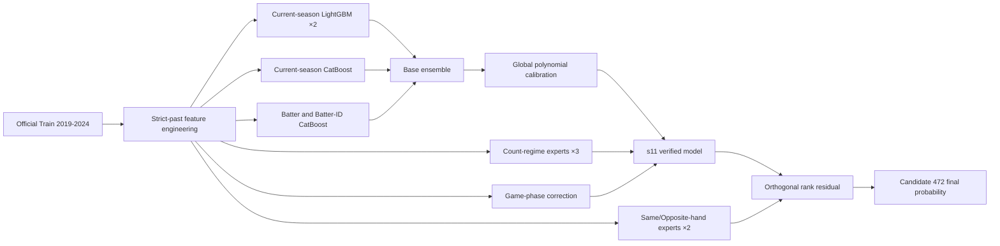

# Strike Ratio

LG Aimers Phase 2에서 투구별 제구 성공 확률을 예측한 개인 프로젝트입니다. 경기 상황과 투구 이전의 선수 기록을 사용했습니다.


| 구분 | 내용 |
|---|---|
| 프로젝트 유형 | LG Aimers Phase 2 해커톤 · 개인 프로젝트 |
| 개발 기간 | 2026.08.05 ~ 2026.09.02 |
| 담당 | 데이터 점검, 피처 생성, 검증, 모델 학습, 앙상블, 확률 보정, 제출물 제작 |
| 예측 대상 | 각 투구의 `control_success=1` 확률 |
| 최종 순위 | **1,087명 중 356위** |
| 내 점수 | **1,046.27893** (`s11_fixed`, 공식 확인 점수) |
| 본선 진출 커트라인 | **1,142.78128** |
| 후속 연구 모델 | Candidate 472 · 투수·타자 손 조합 모델을 결합한 앙상블 |

리더보드에서 확인한 점수는 `s11_fixed`의 1,046.27893점입니다. 이후 만든 Candidate 472는 2022~2024년 전체 Brier Score와 AUC가 개선돼 후속 모델로 남겼습니다. 다만 제출 ZIP에 모델 파일이 빠져 공식 점수는 확인하지 못했습니다. 저장소의 제출물 생성 스크립트에서는 해당 오류를 수정했습니다.

## 프로젝트 개요

### 문제와 접근 방식

이 대회에서는 제구 성공 여부를 맞히는 것뿐 아니라 예측한 확률이 실제 빈도와 얼마나 가까운지도 평가합니다. 성공과 실패를 잘 구분하더라도 확률을 지나치게 높거나 낮게 예측하면 Brier Score가 나빠집니다. 2019~2024 시즌 데이터로 학습해 2025 시즌을 예측해야 했기 때문에 다음에 집중했습니다.

- 투구 시점에 알 수 없었던 정보가 피처에 들어가지 않도록 하기
- 투수·타자와 카운트·주자·경기 상황을 함께 반영하기
- 시즌이 바뀌어도 확률 예측이 크게 흔들리지 않도록 검증하고 보정하기

### 작업 내용

- 약 147만 건의 학습 투구에서 선수와 경기 상황에 관한 피처 생성
- 선수 누적 기록을 해당 투구 이전 데이터로만 계산
- ID 체계가 다른 TrackMan 데이터의 연결 가능성 확인
- 전체 Brier Score와 시즌별·정답별 성능을 함께 비교
- Windows에서 만든 제출 ZIP을 Linux 평가 환경에서 실행할 수 있도록 점검

### 검증 기준

- 현재 투구 결과나 이후 정보를 누적 피처에 넣지 않았습니다.
- 무작위 분할 대신 시즌 순서대로 학습하고 평가했습니다.
- AUC와 Brier Score를 따로 확인하고 확률 보정을 별도로 적용했습니다.
- 전체 평균과 함께 `y=0`, `y=1` 각각의 Brier Score도 확인했습니다.
- 실험 설정, 모델 파일, 체크섬, 제출물 구조를 기록했습니다.
- 테스트 정답과 연결되는 외부 정보나 리더보드 구간별 탐색은 사용하지 않았습니다.

## 평가 방식

예측 확률 `p_i`, 실제 정답 `y_i`, 평가 데이터의 평균 성공률 `r`에 대해 다음 Brier Skill Score를 사용합니다.

```text
Brier Score     = mean((p_i - y_i)^2)
Reference Brier = r * (1 - r)
Score           = max(0, 100000 * (1 - Brier Score / Reference Brier))
```

평가 데이터의 평균 성공률 `r`은 공개되지 않았습니다. AUC가 높아도 확률이 실제 빈도와 어긋나면 점수가 낮아질 수 있어, 모델 학습과 확률 보정을 나눠 진행했습니다.

## 사용 기술

| 영역 | 기술 | 사용 목적 |
|---|---|---|
| Language | Python | 학습·검증·추론·패키징 |
| Data | Pandas, NumPy | 시점 기준 통계, 피처 생성, 대용량 CSV 처리 |
| Gradient Boosting | LightGBM 4.6.0 | 현재 시즌 투수 상태 모델 |
| Categorical Boosting | CatBoost 1.2.10 | 선수 ID, 범주형 상호작용, 전문가 모델 |
| Optimization | SciPy | 앙상블 가중치와 제약식 최적화 |
| Validation | Brier Score, ROC-AUC, rolling-origin | 확률 정확도와 구분력 검증 |
| Integrity | SHA-256, ZIP manifest | 모델 자산 및 제출물 무결성 검사 |
| Version Control | Git, GitHub | 실험 결과와 모델 파일 관리 |

## 데이터

| 데이터 | 규모/기간 | 역할 |
|---|---:|---|
| Train | 1,475,092 투구 · 2019~2024 | 모델 학습과 시즌 순차 검증 |
| Test | 245,789 투구 · 2025 | 최종 확률 추론 |
| TrackMan history | 1,793,078 투구 · 2019~2024 | 구속·무브먼트 등 보조 신호 연구 |

대회 데이터는 라이선스와 용량 문제로 저장소에 올리지 않았습니다. `train.csv`, `test.csv`, `trackman_history.csv`는 Git에서 제외했습니다.

### 주요 피처 그룹

- 경기 상태: 이닝, 아웃카운트, 볼·스트라이크, 주자 상태, 점수 차, 레버리지
- 선수 정보: 투수·타자 ID, 손잡이, 소속 팀, 투타 손 조합
- 누적 능력: 투수·타자 성공률, 중간 제구율, 볼·스트라이크 비율
- 최근 흐름: 이전 1·3·5경기 성공률과 중간 제구율
- 신뢰도: 누적 표본 수, shrinkage 통계, cold-start 여부
- 구종 구성: fastball·breaking·offspeed 비율, entropy, HHI, 구성 차이
- 상호작용: 투수×타자 능력 차이, count×hand, base×outs, leverage×count
- 현재 시즌: 커리어 누적치에서 이전 시즌 baseline을 분리해 계산한 시즌 내 상태

## 모델 구성



### 1. 현재 시즌 기본 모델

두 LightGBM 예측을 `0.6 : 0.4`로 섞은 뒤 CatBoost 예측과 결합했습니다. 이전 시즌까지의 기록과 현재 시즌 누적 기록의 차이로 투수의 최근 상태를 반영했습니다.

### 2. 타자 및 ID 모델

현재 시즌 타자 기록이 충분한 경우에만 타자 상태 모델을 반영했습니다. 타자 ID를 사용하는 CatBoost도 더해 선수별 반복 패턴을 반영했습니다.

### 3. 전역 확률 보정

기본 모델의 예측값에 절편·기울기·고차항을 적용해 확률을 보정했습니다. 이 단계에서 리더보드 점수가 가장 많이 올랐습니다. 2025 시즌에서 예측 확률의 크기를 조정할 필요가 있었던 것으로 보입니다.

### 4. 카운트별 모델

카운트를 세 구간으로 나누고, 각 구간에서 142개 피처를 사용하는 CatBoost 모델을 학습했습니다.

- `balls > strikes`: batter ahead
- `balls = strikes`: even
- `balls < strikes`: pitcher ahead

검증에서 정한 카운트별 모델의 가중치는 `0.0449386515`, 경기 단계별 보정 가중치는 `1.3580533342`입니다.

### 5. 투수·타자 손 조합 모델

투수와 타자의 손 조합을 네 그룹으로 나누면 각 그룹의 표본이 부족했습니다. 그래서 같은 손과 반대 손, 두 그룹으로 묶어 CatBoost 모델을 학습했습니다.

이 모델의 확률을 기존 모델과 그대로 섞으면 AUC는 올랐지만 정답별 Brier Score가 한쪽으로 치우쳤습니다. Candidate 472에서는 두 모델의 logit 차이에서 평균적인 편향을 제거한 뒤 남은 값만 더했습니다.

```text
z_base = logit(p_s11)
delta  = logit(p_hand_expert) - z_base
rank_residual = (delta - (a + b * z_base)) / scale
z_final = z_base + w * rank_residual
p_final = sigmoid(z_final)
```

적용한 값은 다음과 같습니다.

| 파라미터 | 값 |
|---|---:|
| Projection intercept `a` | 0.01615592 |
| Projection slope `b` | -0.12655296 |
| Residual scale | 0.09701518 |
| Rank weight `w` | 0.02396058 |

이렇게 하면 손 조합 모델에서 얻은 투구별 차이는 반영하면서 기존 모델의 평균 확률은 크게 바꾸지 않을 수 있습니다.

## 검증 방법

### Expanding rolling-origin

```text
2019~2021 학습 → 2022 평가
2019~2022 학습 → 2023 평가
2019~2023 학습 → 2024 평가
2019~2024 전체 재학습 → 2025 배포
```

모델과 가중치, 보정값은 선택용 시즌에서 정하고 확인용 시즌에는 바꾸지 않았습니다. 아래 항목을 함께 확인했습니다.

- 전체 Brier delta
- `target=0`, `target=1`별 Brier delta
- ROC-AUC delta
- 시즌·월별 개선 횟수
- 최근 시즌 평균 개선량
- 테스트 데이터 사용 여부와 사전 기록한 설정

### Candidate 471 검증 결과

Candidate 472에 사용한 결합 방식을 `s11_fixed`와 비교한 결과입니다.

| 평가 시즌 | Brier delta | AUC delta | 해석 |
|---|---:|---:|---|
| 2022 | **-0.00003250** | **+0.00030838** | 선택 시즌, 양 타깃 개선 |
| 2023 | **-0.00018680** | **+0.00045012** | 양 타깃 및 전체 개선 |
| 2024 | **-0.00001621** | **+0.00018615** | 전체 개선, 타깃 1 불안정 |

Brier delta는 음수일수록 좋습니다. 전체 Brier Score와 AUC는 세 시즌 모두 개선됐지만, 2024년 `target=1`의 Brier Score는 나빠졌습니다. 이 때문에 Candidate 472의 성능이 모든 그룹에서 안정적이라고 보기는 어렵습니다.

## 실험 결과

### 공식 리더보드에서 확인한 핵심 변화

| 단계 | 점수 | 의미 |
|---|---:|---|
| 초기 고점 기준 | 1008.1374 | 구조·피처 실험의 기준점 |
| 전역 calibration 적용 | 1033.0961 | 모델 순위를 유지한 채 확률 수준 교정 |
| count-regime 구조 개선 | 1044.5371 | 상황별 전문가 신호 추가 |
| `s11_fixed` | **1,046.27893** | 공식 확인 점수. 최종 1,087명 중 356위 |

본선 진출 커트라인은 **1,142.78128점**이었습니다. 내 점수와는 **96.50235점** 차이였습니다.

### 주요 연구 방향

| 방향 | 결과와 판단 |
|---|---|
| LightGBM·XGBoost·CatBoost | 표 형식 데이터에 대한 기준 모델 구축 |
| 현재 시즌 투수·타자 피처 | 최종 앙상블의 핵심 신호로 채택 |
| 타자 ID와 범주형 상호작용 | 반복 선수 패턴 보완, 최종 채택 |
| TabM·FT-Transformer·Wide&Deep·SSL | 최근 시즌에서 꾸준한 개선을 확인하지 못해 제외 |
| 전역 affine·polynomial calibration | 가장 큰 단일 리더보드 개선 |
| Dynamic Beta·상태공간 모델 | 전체 Brier Score는 개선됐으나 확인용 시즌에서 정답별 성능이 엇갈림 |
| GroupDRO·잔차 보정 | 일부 시즌이나 정답의 손실은 줄였지만 일관된 개선은 없었음 |
| TrackMan 피처 | ID를 연결할 수는 있었으나 연결 오류와 시즌 간 성능 차이 때문에 제외 |
| 세밀한 count×hand lookup | 로컬 개선 대비 과적합 위험이 커 중단 |
| 동일/반대 손 전문가 | 모든 평가 연도 AUC 개선, 확률 편향 발생 |
| Orthogonal rank residual | 확률 편향을 줄이면서 구분력 개선을 유지해 후속 모델에 사용 |

상세 실험 기록은 [`docs/EXPERIMENT_LOG.md`](docs/EXPERIMENT_LOG.md), 전체 수치 테이블은 [`docs/results.csv`](docs/results.csv)에 있습니다.

## 시행착오

### 1. 로컬 Brier Score 개선이 리더보드 점수로 이어지지 않음

**문제**
여러 잔차 보정 방법이 2020~2022년 전체 Brier Score를 개선했지만, 2025년 리더보드 점수는 오히려 낮아졌습니다.

**원인**
연도별 평균 성공률이 달랐고, 오래된 시즌의 개선이 전체 평균에 크게 반영됐습니다. 같은 OOF 결과를 반복해서 확인한 탓에 검증 데이터에도 선택 편향이 생겼습니다.

**해결 과정**

- 전체 평균뿐 아니라 2023년과 2024년의 동시 개선을 우선 확인
- expanding rolling-origin으로 검증 재설계
- 최소 개선량과 타깃별 손실 상한 설정
- 확률 보정 이후에도 AUC와 Brier Score가 개선되는지 확인

**결과**
작은 후처리 조정을 줄이고 카운트와 투수·타자 손 조합별 모델을 실험했습니다.

### 2. AUC는 올랐지만 한쪽 정답의 Brier Score는 나빠짐

**문제**
손 조합별 모델은 모든 평가 연도에서 AUC를 높였지만, `target=0` 또는 `target=1` 한쪽의 예측 확률을 지나치게 바꿨습니다.

**원인**
손 조합별 모델의 예측값에는 투구 간 차이뿐 아니라 시즌별 평균 확률의 차이도 들어 있었습니다.

**해결 과정**
손 조합별 모델과 `s11_fixed`의 logit 차이에서 절편과 기울기 성분을 제거하고, 남은 잔차만 결합했습니다.

**결과**
2022~2024년 전체 Brier Score와 AUC가 모두 개선됐습니다. 예측 확률을 그대로 섞을 때보다 정답별 성능 차이도 줄었습니다.

### 3. Train과 TrackMan의 선수 ID가 다름

**문제**

```text
train.csv            → pitcher_id
trackman_history.csv → pitcher_trackman_id
```

두 ID를 그대로 연결할 수 없었습니다.

**해결 과정**

- 시즌×월별 투구 수를 선수 fingerprint로 생성
- 같은 투구손과 활동 시즌으로 후보 제한
- cosine similarity와 활동 시즌 일치도 계산
- mutual-best와 1·2위 margin으로 애매한 매핑 보류
- 고신뢰/중신뢰/미매핑으로 등급화

**결과**
전체 투구의 약 80%를 연결했지만 일부 ID가 잘못 매칭됐고, 2025년 데이터에서의 효과도 불안정했습니다. TrackMan 피처는 최종 모델에서 제외했습니다.

### 4. 미래 정보 누수 위험

**문제**
선수 누적률이나 최근 경기 통계를 잘못 계산하면 현재 투구 결과 또는 이후 경기 정보가 피처에 포함될 수 있습니다.

**해결 과정**

- 모든 누적 피처를 현재 행 이전 시점으로 shift
- 시즌 순서를 보존한 학습·평가
- 테스트 전체 통계를 이용한 보정 금지
- 행별 추론이 다른 테스트 행의 존재에 의존하지 않도록 구성

**결과**
추론에는 대회에서 제공한 해당 시점의 정보와 저장된 모델 파일만 사용합니다.

### 5. Linux 평가 서버에서 제출 ZIP의 모델 파일 누락

**문제**
평가 서버에서 다음 오류가 발생했습니다.

```text
FileNotFoundError: Missing model asset: /app/model/current_season_lgbm_095.txt
```

**원인**
코드에서 `/app/model/...` 경로를 읽는 방식에는 문제가 없었지만, 서버에서 ZIP을 풀었을 때 필요한 모델 파일이 없었습니다. 로컬에서 추론 코드가 실행되는지만 확인하고 ZIP 내부 구조는 충분히 점검하지 못했습니다.

**해결 과정**

- Windows 절대경로 제거, `Path(__file__).resolve().parent` 사용
- `Compress-Archive` 대신 POSIX `/` 엔트리를 생성하는 `tar` 사용
- 필수 자산 16개의 존재 여부 사전 검사
- 원본 모델 파일의 SHA-256 검증
- ZIP 생성 후 내부 엔트리 재검사
- 압축 해제본으로 실제 추론 및 `submission.csv` 생성 확인

**결과**
현재 [`tools/build_submission.ps1`](tools/build_submission.ps1)은 ZIP 내부의 모델 파일과 경로를 검사합니다. 필요한 파일이 없거나 체크섬이 다르면 제출물을 만들지 않습니다.

## 프로젝트 구조

```text
Strike_Ratio/
├── final_model/
│   ├── model/                    # LightGBM·CatBoost 모델과 확률 보정 파일
│   ├── MANIFEST.sha256           # 모델·코드 무결성 체크섬
│   ├── MODEL_CARD.md             # 최종 모델 검증 결과와 위험
│   ├── requirements.txt
│   └── script.py                 # 평가 서버용 추론 코드
├── docs/
│   ├── EXPERIMENT_LOG.md         # 전체 실험 의사결정 기록
│   ├── results.csv               # 실험 수치 테이블
│   └── *_preregistered.json      # 469~472 사전등록 설정
├── tools/
│   └── build_submission.ps1      # POSIX ZIP 생성·무결성 검사
├── .gitattributes
├── .gitignore
└── README.md
```

원본 대회 데이터와 TrackMan CSV, 강의자료, 중간 체크포인트, 과거 제출물은 저장소에 올리지 않았습니다.

## 실행 방법

### 사전 요구사항

- Python 3.10 이상
- 평가 데이터의 원본 컬럼 구조
- 인터넷 연결 없이 설치 가능한 `lightgbm==4.6.0`, `catboost==1.2.10`

### 로컬 추론

평가 서버와 같은 구조로 데이터를 배치합니다.

```text
final_model/
├── data/
│   ├── test.csv
│   └── sample_submission.csv
└── output/
```

```bash
pip install -r final_model/requirements.txt
python final_model/script.py
```

결과는 `final_model/output/submission.csv`에 저장됩니다. 출력 행 수나 `row_id` 순서가 입력과 다르면 오류가 발생합니다.

### 제출 ZIP 생성

Windows PowerShell:

```powershell
./tools/build_submission.ps1
```

생성 결과:

```text
dist/submit.zip
├── model/
├── script.py
└── requirements.txt
```

ZIP 최상위에 추가 폴더가 생기거나 내부 경로에 `\`가 포함되면 빌드가 실패합니다.

## 대회 규칙과 재현성

- 공식 제공 Train 데이터와 허용 범위의 보조 데이터만 사용했습니다.
- 테스트 정답 또는 정답과 직접 연결되는 외부 정보는 사용하지 않았습니다.
- 특정 테스트 행, 선수 ID, 구간을 리더보드 결과에 맞춰 수정하지 않았습니다.
- 확률 보정과 앙상블 가중치는 기록된 실험 결과를 바탕으로 정했습니다.
- 최종 추론은 네트워크 접근 없이 재현됩니다.
- 원본 데이터는 GitHub에 업로드하지 않았습니다.
- 모델 파일과 추론 코드는 [`MANIFEST.sha256`](final_model/MANIFEST.sha256)으로 검증합니다.

## 한계

- 2019~2024년과 2025년의 평균 성공률이 달라 과거 시즌의 성능 개선이 리더보드에서 그대로 나타나지 않았습니다.
- Candidate 472는 2024년 `target=1`에서 기존 모델보다 성능이 나빴고, 공식 점수도 확인하지 못했습니다.
- TrackMan은 ID 연결 오류와 2025년 성능의 불확실성 때문에 최종 모델에 넣지 않았습니다.
- 저장소에 대회 데이터와 전체 학습 체크포인트가 없어, 최종 추론은 재현할 수 있지만 처음부터 다시 학습하려면 원본 데이터가 필요합니다.
- 공식 점수가 확인된 모델은 `s11_fixed`이며, 점수는 **1,046.27893**입니다.

## 회고

### 배운 점

- 이 대회에서는 AUC 개선보다 확률 보정이 점수에 더 큰 영향을 준 경우가 있었습니다.
- 전체 평균이 좋아도 최근 시즌이나 특정 정답에서 성능이 떨어지면 채택하기 어려웠습니다.
- 새 모델의 예측 확률을 그대로 섞기보다 기존 모델과 겹치는 성분을 덜어내는 방식이 더 안정적이었습니다.
- TrackMan 데이터를 쓰려면 피처 자체보다 선수 ID 연결의 정확도와 시간 기준을 먼저 확인해야 했습니다.
- 로컬 실행과 제출 ZIP의 서버 실행은 각각 확인해야 했습니다.

### 아쉬운 점

- 반복 실험으로 동일 OOF에 대한 선택 편향이 누적됐습니다.
- TrackMan 신호를 안정적으로 배포할 만큼 매핑 품질과 validation gap을 해결하지 못했습니다.
- Candidate 472는 제출 ZIP 오류로 공식 점수를 확인하지 못했습니다.

### 다음에 개선한다면

- 처음부터 최종 확인용 데이터를 따로 떼어두고, 실험 횟수도 제한하겠습니다.
- 확률 보정과 순위 성능을 분리해서 최적화하는 방법을 검토하겠습니다.
- 선수의 장기 기록과 최근 시즌 기록을 함께 반영하는 계층형 모델을 살펴보겠습니다.
- Linux 컨테이너에서 ZIP 생성과 추론을 확인하는 자동 검사를 추가하겠습니다.

## 관련 문서

- [최종 모델 카드](final_model/MODEL_CARD.md)
- [전체 실험 로그](docs/EXPERIMENT_LOG.md)
- [실험 결과 테이블](docs/results.csv)
- [469 사전등록 설정](docs/s11_same_opposite_hand_experts_469_preregistered.json)
- [470 사전등록 설정](docs/s11_same_opposite_balanced_470_preregistered.json)
- [471 사전등록 설정](docs/s11_same_opposite_rank_only_471_preregistered.json)
- [472 배포 설정](docs/s11_same_opposite_rank_deploy_472_preregistered.json)
